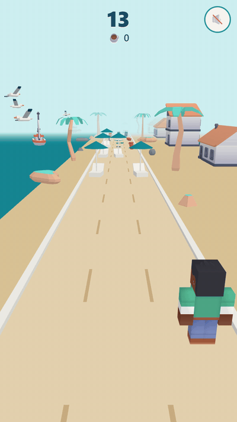

# Brisa Dash

A one-thumb 3D beach runner for phones: dodge the parasols, grab the coffee, beat your score.

**Play it:** https://brisa-dash.pages.dev



## What it is

Brisa Dash is a 3D endless runner made for Brisa Café, a fictional beach café on the Costa del Sol. The idea is a short game people play on their phone while they wait for their coffee, opened from a QR code or a shared link.

It's a self-directed brief exercise, not a commission: the client email in [the brief](docs/BRIEF_brisa-dash.md) is invented. It was built in 2 days, 14–15 October 2026.

Case study: https://ndrew.surfingseagullgames.com/prototypes/brisa-dash/ (not live yet).

## How to play

- **Change lanes:** swipe left or right anywhere on the screen. On a desktop, use the arrow keys or A/D. There are three lanes.
- **Stumble rule:** the first hit doesn't end the run. The barista stumbles, slows to 70% speed and a stumble meter drains over 5 seconds. A second hit while the meter is still draining ends the run. Once it runs out, the next hit counts as a first hit again.
- **Scoring:** +1 point per metre, +10 per coffee mug or takeaway cup, +20 per frappe. The run speeds up over time.
- After a run you can retry with one tap or share your score. The best score is kept on the device.

## Tech

- [Three.js](https://threejs.org), [Vite](https://vite.dev) and [Vitest](https://vitest.dev), in plain JavaScript. No game engine and no physics engine: collisions are lane-plus-distance checks.
- Hosted on Cloudflare Pages, which builds every push to `main`.
- The game logic in `src/game/` (lanes, speed, spawning, collision, stumble, scoring) has no Three.js or DOM imports, so Vitest tests it without WebGL: 12 test files, 70 tests.
- The scene is instanced: each obstacle look, cup kind and scenery model is one `InstancedMesh`, and everything is recycled from small pools instead of building an endless world. Models use flat Lambert materials, with no shadows or post-processing.
- Measured on real phones with `?debug` (from [the build log](docs/buildlog.md)): about 60 FPS on an iPhone 14, with brief dips to around 58, and 118 FPS on an Android phone (model not recorded), both at 42 draw calls. The brief's target was smooth play near 30 FPS.

## Running it locally

Use Node 24, as pinned in `.nvmrc` (Vitest 5 needs Node 22.12 or newer).

```sh
npm install
npm run dev       # dev server, also reachable on your LAN for phone testing
npm test          # run the Vitest suite once
npm run build     # production build into dist/
npm run credits   # regenerate CREDITS.md from src/credits.json
```

`npm test` also fails if any file in `public/models/` or `public/sounds/` has no credit entry, or if `CREDITS.md` is out of date.

## Tuning

Add `?debug` to the URL to show FPS and draw calls. With `?debug`, any number in [`src/game/config.js`](src/game/config.js) can be overridden from the URL, and the debug panel lists the overrides that are active. Nested shares use a dotted key, such as `cupLineMix.frappe` or `obstacleMix.parasol`.

- No seagulls: https://brisa-dash.pages.dev/?debug&seagullCount=0
- More two-lane rows, closer together: https://brisa-dash.pages.dev/?debug&twoBlockedChance=0.8&rowGapGrowth=0.3

## Project structure

```
docs/       brief, GDD, execution plan, build log, brand palette, README media
public/     3D models, sounds and the link-preview image, served as-is
scripts/    the credits generator (src/credits.json → CREDITS.md)
src/
  game/     pure game logic and config.js, unit-tested
  render/   Three.js scene, world, models and entities
  ui/       input, screens, sharing, audio, best score, debug panel
tests/      Vitest tests
```

## How it was built

The code was written with an AI-assisted workflow, using Claude Code. I directed the work and reviewed it on my phone. Each step has a document in `docs/`:

1. [BRIEF_brisa-dash.md](docs/BRIEF_brisa-dash.md): the invented client email and the scoped brief.
2. [GDD.md](docs/GDD.md): the game design document, reviewed before any code.
3. [execution-plan.md](docs/execution-plan.md): Phases 0–6, each ending in something playable and testable.
4. [buildlog.md](docs/buildlog.md): a log of every session, with the directions I gave, the decisions made, what broke and the test results.

The commit history follows the same phases.

All art and sound come from human-made CC0 and CC BY asset packs, plus shapes built in code (the track, parasols, café tables, menu boards and seagulls).

## Credits and licence

Every third-party asset is listed in [CREDITS.md](CREDITS.md), and the same list is in the game's Credits screen. Most assets are CC0 packs by [Kenney](https://kenney.nl).

One model is CC BY 4.0 and needs attribution: ["Low-Poly Takeaway Coffee Cup"](https://skfb.ly/oxqpp) by PickledCactusAlan, licensed under [CC BY 4.0](http://creativecommons.org/licenses/by/4.0/). It's recoloured in code (Sunset Coral body, Sea Salt White lid); the original texture isn't used.

The code is released under the [MIT License](LICENSE). Third-party assets keep their own licences, as listed in CREDITS.md. Brisa Café is a fictional café made up for this project.
